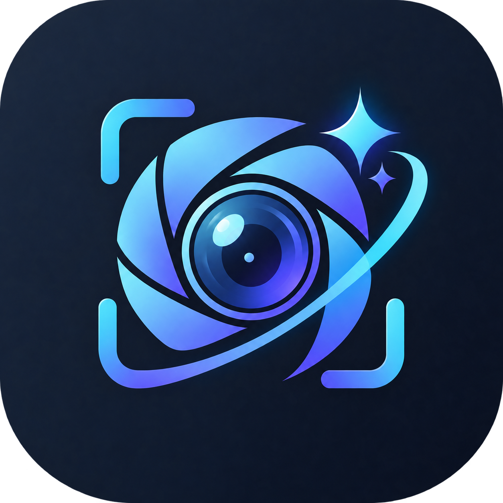
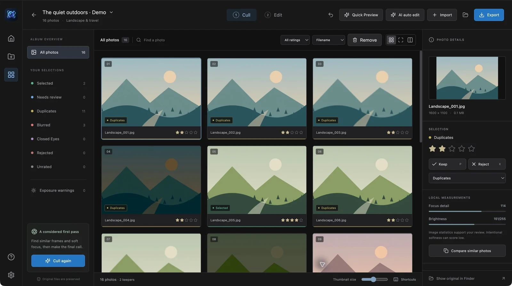
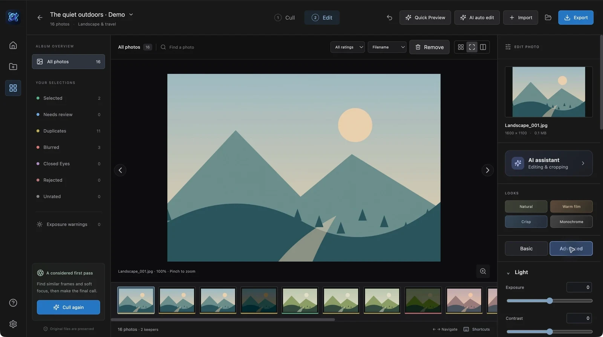
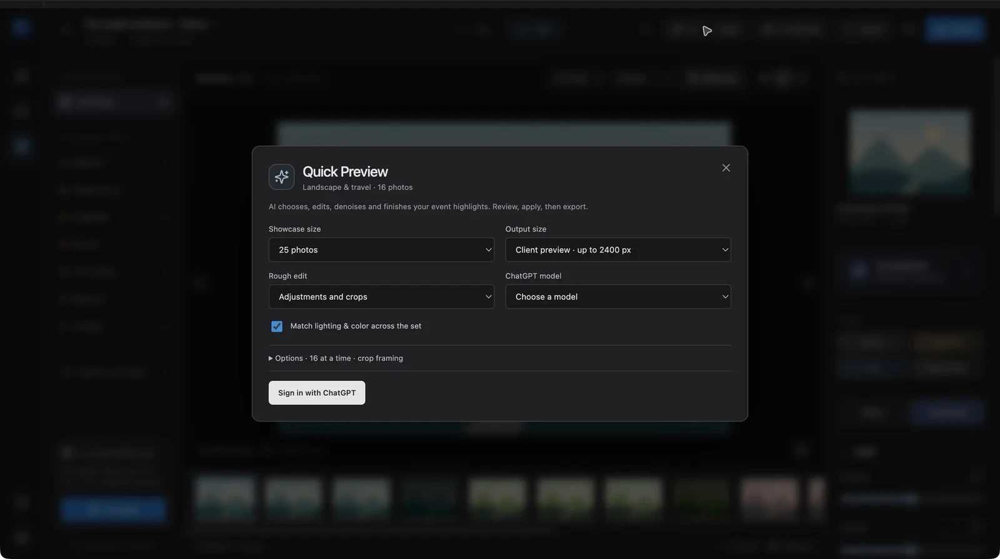

  

<h1 align="center">OpenShoot</h1>

  <a href="https://github.com/codebooker/OpenShoot/releases/latest"><strong>Download for Mac</strong></a>
  · <a href="docs/setup.md">Setup & building</a>
  · <a href="SECURITY.md">Privacy</a>

### Cull

### Edit

### Quick Preview

Screenshots show the app's generated demo illustrations.

Apple Silicon · macOS 13+ · Early access. The current DMG is ad-hoc signed, not Apple-notarized. Installation details are in [setup](docs/setup.md).

[AGPL-3.0](LICENSE) · [Third-party notices](THIRD_PARTY.md)
